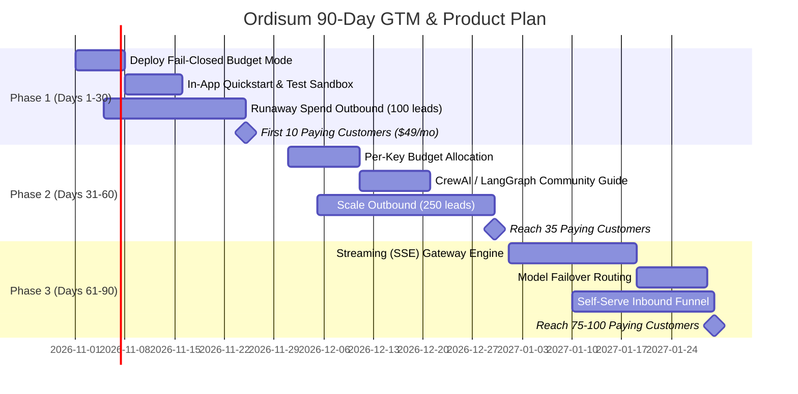

# Ordisum 90-Day GTM and Product Plan

**Target Objective:** Acquire the first **50–100 paying customers** ($49–$299/mo) within 90 days by establishing Ordisum as the indispensable **AI Budget Firewall & Unit-Cost Governance Engine** for autonomous background workloads.

---

## 1. Executive Positioning & Core Thesis

### The Positioning Statement
> **"Ordisum is the zero-overhead API proxy that puts hard budget kill-switches and precision FinOps controls on autonomous AI agents, background pipelines, and batch LLM workloads."**

### Why This Wins Today
1. **Clear, Urgent Value:** While general observability tools (LangSmith, Langfuse, Helicone) tell you *how much money you lost after the fact*, Ordisum actively **prevents runaway bills** with pre-request HTTP 429 hard budget blocking.
2. **Sidesteps the Streaming Weakness:** By exclusively targeting asynchronous, headless workloads (web scrapers, data extraction pipelines, agent swarms, internal bots), the current lack of streaming response handling (`stream: true`) is completely irrelevant.
3. **Frictionless Integration:** Requires exactly 1 line of configuration in Python or TypeScript (`base_url="https://api.ordisum.com/v1"`). No new SDKs to install, no vendor lock-in.

---

## 2. Target ICP & Buyer Personas

### Primary ICP: Autonomous AI Agent & Background-Workflow Companies
- **Profile:** Seed to Series A AI startups (3–20 engineers).
- **Core Stacks:** Python/TypeScript, CrewAI, AutoGen, LangGraph, custom asyncio/BullMQ workers.
- **Workflow Pattern:** Running continuous autonomous loops, web scraping, automated research, multi-step code synthesis, or asynchronous report generation.
- **Primary Buyer:** **CTO / Technical Co-Founder** (signs off on API infrastructure, owns cloud & LLM budget).
- **Secondary Champion:** **Lead AI Engineer / Backend Architect** (experiences the pain of debugging unexpected spend spikes and setting up rate limits).

### Secondary ICP: Batch Document-Processing & Content Pipelines
- **Profile:** Vertical SaaS companies processing high volumes of PDFs, invoices, contracts, or audio transcripts (e.g., LegalTech, InsurTech, FinTech).
- **Primary Buyer:** **VP of Engineering / Head of Product**.
- **Core Need:** Protecting gross margins. They need exact, audited LLM costs per document or per tenant to prove unit economics to investors and leadership.

---

## 3. Trigger Signals & Prospect Research

### High-Intent Trigger Signals
Look for companies and technical leads exhibiting these public signals on LinkedIn, X (Twitter), GitHub, and Reddit:
1. **"The Runaway Bill" Post:** Founder or engineer complaining about an accidental $1,000+ OpenAI/Anthropic bill caused by an infinite loop, test script, or misconfigured retry mechanism.
2. **Autonomous Agent Launches:** Startups announcing multi-agent workflows, long-running agent architectures, or automated browser agents on Product Hunt or Hacker News.
3. **Hiring for AI Infrastructure / FinOps:** Job postings seeking "AI Platform Engineer" or mentions of "optimizing LLM inference costs" in job descriptions.
4. **Funding Milestones:** Startups announcing pre-seed or seed funding ($500k–$3M) with an active AI product in public beta (they now have real customer volume and real credit card exposure).

### Lead Qualification Scorecard (10-Point System)

| Qualification Dimension | Criteria for High Score (2 pts) | Criteria for Medium Score (1 pt) | Disqualifier (0 pts) |
| :--- | :--- | :--- | :--- |
| **Workload Architecture** | Asynchronous workers, batch processing, background agents | Hybrid (some batch, some conversational) | 100% interactive conversational chat (requires streaming) |
| **Monthly LLM Spend** | $1,500 – $20,000 / month | $500 – $1,500 / month | <$300 / month (no pain) or >$50k (needs custom VPC) |
| **Team Size & Velocity** | 3–15 engineers deploying weekly | 1–2 founders or 16–40 engineers | 100+ enterprise (long procurement cycles) |
| **Provider Diversity** | Uses 2+ providers (e.g. OpenAI + Claude + Groq) | Uses 1 provider, plans to expand | Exclusively on AWS Bedrock with locked IAM |
| **Buyer Access** | Direct access to CTO / Tech Founder on LinkedIn/X | Access to Senior Engineer | Bureaucratic procurement department |

*Target Threshold:* Only reach out to prospects scoring **7/10 or higher**.

---

## 4. The 3 Customer Acquisition Experiments

### Experiment 1: The "Runaway Spend Audit" Outbound Campaign
- **Channel:** Direct personalized LinkedIn & X outreach to 200 technical founders of AI agent startups.
- **Hook:** *"Did you see the recent thread about an agent burning $4,200 on GPT-4o overnight? How are you currently stopping infinite loops in your background workers?"*
- **Offer:** A 15-minute technical demo showing a live agent loop getting hard-blocked at a $50 daily cap with an instant Slack notification. Free 30-day Pro pilot.
- **Conversion Goal:** 30 discovery calls booked, 15 pilots launched, 8 paying conversions.

### Experiment 2: The Open-Source Agent Framework Partnership & Community
- **Channel:** Discord, GitHub Discussions, and subreddits for CrewAI, LangGraph, AutoGen, and LiteLLM.
- **Hook:** Produce an open-source guide and template: *"How to add a Hard Budget Kill-Switch to CrewAI/LangGraph in 1 Line of Code."*
- **Asset:** A clean GitHub gist and short video demonstration showing Ordisum blocking an infinite while-loop agent.
- **Conversion Goal:** 50 self-serve developer signups, 10 activated paid teams.

### Experiment 3: Margin-Protection Audits for Vertical SaaS Founders
- **Channel:** Cold email to 150 founders of Document Extraction / LegalTech AI startups.
- **Hook:** *"Most document processing SaaS companies are overpaying by 35% on Anthropic and OpenAI because they lack exact per-document token attribution. We built an automated report that tracks your exact unit margins down to 6 decimal places."*
- **Offer:** Free audit of their last month's token usage using Ordisum's PDF/Excel reporting engine.
- **Conversion Goal:** 20 calls booked, 10 pilots, 5 enterprise tier conversions ($199–$499/mo).

---

## 5. The Founder-Led Pilot Offer ("The Zero-Risk Budget Firewall")

To eliminate all friction during sales conversations, offer a standardized, no-brainer 30-day pilot:

### The Pilot Structure
1. **1-Line Integration:** Switch `base_url` to Ordisum on their staging or secondary background worker environment.
2. **Guaranteed Protection:** Set a hard budget cap of $100 (or their custom threshold).
3. **Zero Upfront Cost:** 30 days free access to the Pro tier (normally $99/mo).
4. **Shared Slack Channel:** Direct Connect Slack channel with the Ordisum founder for real-time support and feature requests.
5. **The Close Condition:** If Ordisum successfully catches any runaway spike, blocks an unauthorized test, or provides actionable margin clarity within 30 days, they convert to the standard plan ($99/mo).

---

## 6. Cold Outreach & Social Selling Scripts

### LinkedIn Outreach (Target: Seed-Stage CTO / AI Founder)
> **Subject / Note:** *Quick question on your agent background workers*
>
> *"Hey [First Name], saw you’re scaling [Company]’s autonomous agent pipeline—really impressive build.*
>
> *Curious: how are you guys handling runaway loop protection on OpenAI/Claude right now? Most teams we talk to rely on OpenAI’s native alerts, which have a 24-hour delay and don’t actually stop the script.*
>
> *We built Ordisum to act as a 1-line proxy firewall that returns an active 429 the second an agent hits a daily or monthly budget cap, plus instant Slack alerts.*
>
> *Open to taking a quick 10-minute look this week?"*

### Follow-Up Message (3 Days Later)
> *"Hey [First Name], completely understand if you're swamped. In case it’s useful, here’s a 45-second screen recording of our gateway cutting off a rogue 500-request batch at exactly $25.00 before it could hit upstream providers: [Link]*
>
> *Happy to set you guys up with a free 30-day sandbox key if you want to test it on your staging workers."*

---

## 7. 30 / 60 / 90 Day Milestone Roadmap

### Days 1–30: Validation & First 10 Paid Customers
- **Engineering Priorities:**
  1. Add configurable `fail_closed: boolean` to budget enforcement ([backend/src/services/aiGateway.js](file:///c:/Users/AL-Rehmat/OneDrive/Desktop/NEW%20ROI/backend/src/services/aiGateway.js)).
  2. Build in-dashboard "Test Ping" button on API Keys page so users verify gateway connection in <10 seconds.
  3. Verify Resend email deliverability and add a "Send Test Budget Alert" button in settings.
- **GTM Priorities:**
  1. Conduct 30 customer discovery calls with technical founders of background agent startups.
  2. Launch Experiment 1 (Outbound spend audit).
  3. Close **10 paying customers** ($49–$99/mo).

### Days 31–60: Expansion & Community Inbound (Reach 35–50 Customers)
- **Engineering Priorities:**
  1. Implement **Per-Key & Tag-Based Hard Budgets** so teams can assign different budget caps to staging vs production keys.
  2. Automated weekly email digest sending the PDF cost report to org admins.
- **GTM Priorities:**
  1. Publish technical case studies: *"How [Customer X] saved $1,800/mo by catching unhandled agent retries."*
  2. Launch Experiment 2 (CrewAI & LangGraph community integration guides).
  3. Ramp outbound to 50 targeted leads/week.

### Days 61–90: Scale to 100 Customers & Unlock Streaming
- **Engineering Priorities:**
  1. **Architect and release SSE Streaming Passthrough:** Open up the massive interactive chat and coding assistant markets without latency degradation.
  2. Implement **Automatic Model Fallback:** If upstream Claude 3.5 Sonnet returns 529 Overloaded, seamlessly retry against GPT-4o.
- **GTM Priorities:**
  1. Launch on Product Hunt and Hacker News Show HN with the streaming + budget firewall narrative.
  2. Convert free tier users to annual paid plans with volume discounts.
  3. Reach **75–100 paying customers** ($5,000–$10,000 MRR).

---

## 8. Prioritized Engineering Backlog Tied to Customer Pain

| Priority | Feature / Fix | Exact Problem Solved | Codebase Touchpoints | Estimated Effort |
| :---: | :--- | :--- | :--- | :---: |
| **P0** | **Fail-Closed Budget Flag** | Prevents spend leaks if Supabase has transient latency during budget checks | [backend/src/services/aiGateway.js](file:///c:/Users/AL-Rehmat/OneDrive/Desktop/NEW%20ROI/backend/src/services/aiGateway.js#L110) | 2 hours |
| **P0** | **Dashboard Quickstart Test Widget** | Eliminates confusion on whether gateway is working after API key creation | [frontend/src/pages/ApiKeys.tsx](file:///c:/Users/AL-Rehmat/OneDrive/Desktop/NEW%20ROI/frontend/src/pages/ApiKeys.tsx) | 1 day |
| **P1** | **Per-Key & Tag-Based Budgets** | Enables separating dev/staging budgets from production pipelines | `supabase/migrations/`, [aiGateway.js](file:///c:/Users/AL-Rehmat/OneDrive/Desktop/NEW%20ROI/backend/src/services/aiGateway.js) | 3 days |
| **P1** | **One-Click Test Alert Button** | Lets users verify Slack and Email deliverability without hitting budget | [backend/src/routes/alerts.js](file:///c:/Users/AL-Rehmat/OneDrive/Desktop/NEW%20ROI/backend/src/routes/alerts.js), [frontend/src/pages/Alerts.tsx](file:///c:/Users/AL-Rehmat/OneDrive/Desktop/NEW%20ROI/frontend/src/pages/Alerts.tsx) | 1 day |
| **P2** | **SSE Streaming Passthrough** | Unlocks interactive conversational AI, coding assistants, and voice agents | [backend/src/routes/v1.js](file:///c:/Users/AL-Rehmat/OneDrive/Desktop/NEW%20ROI/backend/src/routes/v1.js), [backend/src/services/aiGateway.js](file:///c:/Users/AL-Rehmat/OneDrive/Desktop/NEW%20ROI/backend/src/services/aiGateway.js) | 5 days |
| **P2** | **Automatic Model Fallback Routing** | Protects against single-provider upstream outages (e.g. Anthropic 529s) | [backend/src/services/aiGateway.js](file:///c:/Users/AL-Rehmat/OneDrive/Desktop/NEW%20ROI/backend/src/services/aiGateway.js) | 4 days |

---

## 9. Key Performance Indicators (KPIs) & Experiment Guardrails

### Core Metrics Dashboard
1. **Activation Rate:** % of new signups that send at least 10 gateway requests through `/v1/chat/completions` within 24 hours of account creation. (Target: **>45%**).
2. **Hard-Block Utility:** Number of requests successfully blocked by `checkHardLimits` with HTTP 429 (Proves value to customer: *"Ordisum saved you $X today"*).
3. **Gateway P95 Latency Overhead:** Gateway proxy processing time excluding upstream provider execution. (Target: **<35ms**).
4. **Monthly Customer Retention:** % of paying organizations active month-over-month. (Target: **>90%**).

### Experiment Review & Kill Criteria

- **Experiment 1 (Outbound Spend Audit):**
  - *Keep Scaling:* If reply rate > 8% and at least 15% of meetings convert to active pilots.
  - *Pivot / Kill:* If 100 personalized messages yield < 3 replies. Pivot messaging from "budget firewall" to "margin accounting per customer."
- **Experiment 2 (Framework Community Guides):**
  - *Keep Scaling:* If GitHub gists/guides drive > 30 weekly signups with > 30% activation.
  - *Pivot / Kill:* If traffic bounces without creating API keys; redesign the quickstart onboarding wizard.
- **Streaming Milestone Review (Day 60):**
  - If background worker acquisition achieves >30 paying customers by Day 60, maintain streaming as P2; if demand consistently stalls due to prospective customers demanding chat support, elevate streaming to P0 immediate sprint.
